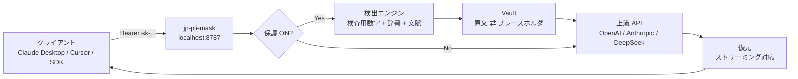

# jp-pii-mask

**日本語に特化した、AI API 向けの個人情報マスキング／自動復元プロキシ。**

ローカルで動く 1 つのプロキシが、AI へ送るリクエスト本文から個人情報を検出して
プレースホルダに置き換え、応答が返ってきたら元の文字列に自動で戻します。
普段使っている AI アプリの接続先を `http://127.0.0.1:8787` に変えるだけで導入できます。

```
あなたの文章 ──▶ [ jp-pii-mask ] ──▶ OpenAI / Claude / DeepSeek / Gemini …
                        │  個人情報を [氏名_1] に置換
                        │
  元の文章に復元 ◀──────┘  AI の応答を自動復元
```

**AI には「田中太郎」が見えず、あなたには見える。** これがこのツールの全てです。

---

## 目次

- [なぜ必要か](#なぜ必要か)
- [主な特徴](#主な特徴)
- [クイックスタート](#クイックスタート)
- [PDF・画像ファイルのマスク](#pdf画像ファイルのマスク)
- [AI アプリへの接続設定](#ai-アプリへの接続設定)
- [検出できる個人情報](#検出できる個人情報)
- [動作の仕組み](#動作の仕組み)
- [設定](#設定)
- [デスクトップ GUI](#デスクトップ-gui)
- [検証状況](#検証状況)
- [制限事項](#制限事項)
- [ライセンスと商用利用](#ライセンスと商用利用)
- [開発](#開発)
- [ロードマップ](#ロードマップ)

---

## なぜ必要か

ChatGPT や Claude に業務文書を貼り付けるとき、こんな情報が混ざっていませんか。

- 顧客の氏名・住所・電話番号・メールアドレス
- マイナンバー、法人番号、保険証番号、免許証番号
- 取引先の法人名、銀行口座番号、クレジットカード番号

いったん送信すれば、その内容がどう扱われるかを自分で制御するのは困難です。
かといって毎回手で伏せ字にするのは現実的ではありません。

`jp-pii-mask` は**送信の直前に自動で伏せ、返答で自動で戻す**ことで、
「AI の便利さ」と「個人情報を渡さない」を同時に成立させます。

---

## 主な特徴

- **可逆マスキング** — AI には `[氏名_1]` として渡り、あなたの画面には「田中太郎」と戻る。
  会話の文脈（誰が誰か、同じ人物が一貫して同じ記号になる）も保たれます。
- **日本語に特化** — 敬称の扱い、丁目・番地・号、全角数字、元号表記、
  マイナンバー・法人番号の**検査用数字**まで検証します。
- **検証つき検出** — 日本の公的番号はチェックディジットで確認するため、
  「たまたま 12 桁だった数字」を個人情報と誤認しません。
- **ストリーミング対応** — ChatGPT / Claude の逐次応答でも、
  プレースホルダが途中で分割されても壊れずに復元します。
- **ローカル完結** — 検出も復元もあなたの PC 上で完結。原文を外部に送りません。
- **PDF・画像ファイルも** — スキャンした請求書や写真も、黒塗りした本体と
  復元用テキストをローカルで出力します（任意機能。OCR は Windows 標準を使用）。
- **監査しやすい** — 中核の依存は 5 つだけ。Vault（対応表）は AES-GCM で暗号化して保存。
- **OpenAI / Anthropic 互換** — ほぼ全ての LLM ツールがそのまま使えます。

---

## クイックスタート

### 必要なもの

- Python 3.10 以上（動作確認は 3.12）

### インストール

```bash
git clone <このリポジトリ>
cd jp-pii-mask
python -m pip install -e .
```

### 起動

```bash
jp-pii-mask serve
```

```
  🌙 jp-pii-mask v0.1.0
  ─────────────────────────────────────────
  制御パネル : http://127.0.0.1:8787/
  転送先 API : https://api.openai.com
  保護状態   : ON
  ─────────────────────────────────────────
```

ブラウザで <http://127.0.0.1:8787/> を開くと制御パネルが出ます。
ここから **ON/OFF**、**転送先 API**、**API キー**を設定できます。

### マスク・復元を試す

送信先を用意しなくても、動作を確認できます。

```bash
jp-pii-mask demo
```

```
【原文】
お世話になっております。株式会社サンプル商事 営業部の田中太郎です。
私の携帯は090-1234-5678、メールは taro.tanaka@example.co.jp です。
請求書の送付先は〒100-0001 東京都千代田区千代田1-1 サンプルビル5階です。
マイナンバーは 123456789018、法人番号は 3234567890123 です。
念のため、実家の電話 03-1234-5678 も控えておいてください。

【マスク後 (API に送られる形)】
お世話になっております。[法人名_1] 営業部の[氏名_1]です。
私の携帯は[電話番号_1]、メールは [メールアドレス_1] です。
請求書の送付先は[住所_1] サンプルビル5階です。
マイナンバーは [マイナンバー_1]、法人番号は [法人番号_1] です。
念のため、実家の電話 [電話番号_2]も控えておいてください。

  検出: 8 件 / 種別: {'ORGANIZATION': 1, 'PERSON': 1, 'PHONE': 2, 'EMAIL': 1,
                       'POSTAL_ADDRESS_FULL': 1, 'MYNUMBER': 1, 'CORPORATE_NUMBER': 1}

【復元後 (API から返ってきた想定)】
お世話になっております。株式会社サンプル商事 営業部の田中太郎です。
…（原文と完全に一致）

────────────────────────────────────────────────────────────
往復一致: PASS  (復元 8 件 / 未復元 0 件)
```

> このデモのマイナンバー `123456789018` と法人番号 `3234567890123` は
> **検査用数字が正しい値**です。検査用数字の合わない 13 桁
> （`1234567890123` など）は法人番号として検出されません。

---

## PDF・画像ファイルのマスク

プロキシを通さず、**手元のファイルを直接**伏せ字にしたいときは `file` サブコマンドを使います。

```bash
python -m pip install -e ".[file]"          # PDF・画像対応 (Pillow + pypdfium2)
python -m pip install -e ".[ocr-win]"       # スキャン PDF・写真の文字認識 (Windows のみ)

jp-pii-mask file mask 請求書.pdf
```

```
マスクしました: 請求書.pdf
  出力ファイル : 請求書.masked.pdf
  テキスト     : 請求書.masked.txt
  対応表       : 請求書.masked.vault (restore に使用)
  ページ       : 2 (マスク 1 / OCR 0)
  検出         : 7 件 {'ORGANIZATION': 1, 'PERSON': 1, 'PHONE': 1, ...}
```

| 出力 | 中身 |
|---|---|
| `請求書.masked.pdf` | 個人情報を黒塗りした本体。**見た目は戻せません** |
| `請求書.masked.txt` | プレースホルダ入りのテキスト。AI にはこちらを渡します |
| `請求書.masked.vault` | 復元用の対応表（AES-GCM で暗号化） |

AI に `.masked.txt` を渡し、返ってきた文章に `[電話番号_1]` が現れたら、
対応表でいつでも元の文字列に戻せます。

```bash
jp-pii-mask file restore 回答.txt --vault 請求書.masked.vault
```

- 画像（PNG / JPEG / BMP / WebP / TIFF）と PDF に対応
- **個人情報が無いページはベクタのまま**複製されるため、画質は劣化しません
- 個人情報があったページだけ画像化し、**テキスト層を除去**します
- `--ocr auto`（既定）は、テキスト層が無い（＝スキャンの）ページだけ OCR します
- OCR は Windows 標準 OCR（OS 内蔵）を使うため、クラウドへの送信はありません
- 注意: **マスク済みファイル（PDF・画像）自体は復元できません**。
  復元できるのは `.masked.txt` のテキストだけです

---

## AI アプリへの接続設定

転送先の API キーは、環境変数か制御パネルから設定します。

### OpenAI 互換のアプリ全般

```bash
export OPENAI_BASE_URL="http://127.0.0.1:8787/v1"
export OPENAI_API_KEY="sk-..."   # 本物のキーはプロキシが転送します
```

### Claude Code / Anthropic SDK

```bash
export ANTHROPIC_BASE_URL="http://127.0.0.1:8787"
export ANTHROPIC_API_KEY="sk-ant-..."
```

### 個別のアプリ

| アプリ | 設定箇所 | 値 |
|---|---|---|
| Cursor | Settings → Models → Override OpenAI Base URL | `http://127.0.0.1:8787/v1` |
| Continue (VS Code) | `config.json` の `apiBase` | `http://127.0.0.1:8787/v1` |
| OpenAI Python SDK | `OpenAI(base_url=...)` | `http://127.0.0.1:8787/v1` |
| curl | `--url` | `http://127.0.0.1:8787/v1/chat/completions` |

> **ヒント:** アプリごとに `x-jp-pii-session` ヘッダを付けると復元表が分離され、
> 別のアプリの会話と取り違える事故を防げます。

---

## 検出できる個人情報

| 種別 | 例 | 判定方法 |
|---|---|---|
| 氏名 | 田中太郎、佐藤様、鈴木さくらさん | 姓辞書 + 敬称 + 文脈 |
| 法人名 | 株式会社サンプル商事、サンプル工業株式会社 | 法人格 + 名称 |
| 住所 | 東京都千代田区千代田1-1 | 都道府県アンカー + 丁目番地 |
| 郵便番号 | 〒100-0001 | 形式 + 〒 |
| 電話番号 | 090-1234-5678、03-1234-5678、0120-123-456 | 桁数 + 先頭 0 の検証 |
| メールアドレス | taro@example.co.jp | 形式 |
| マイナンバー | 123456789018 | **検査用数字** |
| 法人番号 | 3234567890123 | **検査用数字** |
| クレジットカード | 4242 4242 4242 4242 | **Luhn 検査** |
| 生年月日 | 1990年1月1日、平成2年5月3日 | 形式 |
| 銀行口座 | 普通 1234567 | 種別語 + 数字 |
| 基礎年金番号 | 1234-567890 | 形式 + 文脈 |
| 運転免許証番号 | 123456789012 | 形式 + 文脈 |
| パスポート番号 | AB1234567 | 形式 + 文脈 |
| IP アドレス | 192.168.10.24 | 形式 + 範囲検証 |
| API キー | sk-…、sk-ant-…、AIza… | 形式 |

### 文脈語による精度調整

「電話番号: 03-1234-5678」のように文脈語が近くにあると信頼度が上がり、
無い場合は下がります。「田中」が人名か地名かも、周辺語から判断します。

### 誤検出を避ける設計

- 検査用数字が合わない 12 桁はマイナンバーと**断定しません**
- 文脈の無い 7 桁を郵便番号と**断定しません**
- 「林」「森」「原」など姓と同形の一般名詞は単独では人名にしません
- `tools` の JSON Schema や `model` 名はマスク対象から**除外**します（AI の動作を壊さないため）

---

## 動作の仕組み



1. **検出** — リクエスト本文を解析し、個人情報の位置を特定
2. **置換** — Vault に記録しながらプレースホルダへ置換
3. **転送** — 上流 API へ送信（API キーはそのまま通過）
4. **復元** — 応答内のプレースホルダを原文へ戻す

詳細は [`docs/ARCHITECTURE.md`](docs/ARCHITECTURE.md) を参照してください。

### なぜ自前実装なのか

[MIT ライセンスの既存 OSS](docs/LICENSING.md)（Presidio / LiteLLM / Tauri）を
土台にする方針は維持しつつ、**検出と可逆マスキングの中核は自前**で実装しています。

- Presidio の日本語対応は実務精度に届かず、フォーク保守のコストが高い
- 可逆復元は「漏らさない」ことが最優先で、プレースホルダ設計を自分の管理下に置きたい
- 依存を 5 つに抑えることで、監査と単一バイナリ化が容易になる

GUI 層は **Tauri 2**（MIT）を採用し、`desktop/` に雛形を同梱しています。

---

## 設定

設定ファイルの場所:

- Windows: `%USERPROFILE%\.jp-pii-mask\config.json`
- macOS / Linux: `~/.jp-pii-mask/config.json`

環境変数 `JP_PII_MASK_HOME` で変更できます。

### CLI

```bash
jp-pii-mask serve --port 8787 --preset deepseek
jp-pii-mask detect "田中太郎の携帯は090-1234-5678です。"
jp-pii-mask mask   "田中太郎です。" --json
jp-pii-mask config --show
jp-pii-mask config --set enabled=true --set min_confidence=0.6
```

### 主な設定項目

| キー | 既定 | 説明 |
|---|---|---|
| `enabled` | `true` | プロキシ全体の ON/OFF |
| `masking_enabled` | `true` | マスキングの ON/OFF |
| `restore_responses` | `true` | 応答の復元 ON/OFF |
| `upstream` | `https://api.openai.com` | 転送先ベース URL |
| `upstream_preset` | `openai` | 認証方式の切り替え（anthropic は `x-api-key`） |
| `api_key` | `""` | 空なら環境変数を使用 |
| `store_api_key` | `false` | `true` で設定ファイルに保存（0600） |
| `min_confidence` | `0.5` | この値未満の検出を捨てる |
| `custom_terms` | `[]` | 追加で必ずマスクしたい語（プロジェクト名など） |
| `use_ner` | `false` | GiNZA を使う（任意インストール） |
| `redact_only` | `false` | `true` なら復元せず完全消去 |
| `vault_encrypt` | `true` | 対応表を暗号化して保存 |
| `vault_ttl_hours` | `24` | セッションの保持時間 |

### 管理 API

デスクトップ GUI と同じ経路です。<http://127.0.0.1:8787/> はこの API を叩いています。

| メソッド | パス | 説明 |
|---|---|---|
| `GET` | `/healthz` | 死活確認 |
| `GET` | `/admin/api/state` | 現在の状態・統計（**API キーは返しません**） |
| `POST` | `/admin/api/state` | 設定変更 |
| `POST` | `/admin/api/toggle` | ON/OFF 切り替え |
| `GET` | `/admin/api/detect?text=…` | 検出プレビュー（マスクしない） |
| `GET` | `/admin/api/mapping` | 現在の対応表（ローカル限定） |

> **安全性:** `Origin` ヘッダが付いた要求はローカル系オリジン
> （`localhost` / `127.0.0.1` / `tauri.localhost`）以外すべて拒否します。
> 悪意ある Web サイトが管理 API を読んで原文を抜き取ることを防ぐためです。

### より高精度にしたい場合（任意）

```bash
python -m pip install -e ".[ner]"
jp-pii-mask serve --ner
```

未インストールでもルールベース + 辞書で動作します（劣化モード）。

---

## デスクトップ GUI

`desktop/` に **Tauri 2** のメニューバー常駐アプリを同梱しています。
macOS のメニューバー / Windows のタスクトレイに常駐し、ワンクリックで ON/OFF できます。

```
メニューバー 🌙
 ├─ ☑ マスキング保護 ON/OFF
 ├─ 設定を開く
 └─ 終了
```

### インストーラを作る

リポジトリにある次のファイルを**ダブルクリックするだけ**です。
Rust（組み立ての道具）の導入からインストーラの作成まで、すべて自動で行います。

| お使いのパソコン | ダブルクリックするファイル |
| --- | --- |
| Windows | `インストーラを作る.bat` |
| macOS | `インストーラを作る.command` |

コマンドで実行したい場合（上級者向け）:

```bash
python desktop/scripts/build-installer.py                # アプリとインストーラを作る
python desktop/scripts/build-installer.py --check-only    # 組み立てられるかだけ確認
python desktop/scripts/build-installer.py --skip-sidecar  # 内蔵サーバーを作り直さない
```

できあがるもの:

- Windows: `desktop/src-tauri/target/release/bundle/msi/*.msi` と `nsis/*-setup.exe`
- macOS: `desktop/src-tauri/target/release/bundle/dmg/*.dmg`

**インストーラの入手と使い方は、エンジニアでない方向けに
[`desktop/INSTALL.md`](desktop/INSTALL.md) にまとめています。**

### GitHub Actions での自動ビルド

`.github/workflows/build-installers.yml` が、Mac / Windows 用の
インストーラ（`.dmg` / `.msi`）を自動で作ります。

- **Actions** タブ →「build-installers」→「Run workflow」で実行
- タグ（例: `v0.1.0`）を push すると、GitHub の Release に下書きとして添付
- 手動実行でも成果物（Artifacts）からダウンロード可能

> **Rust が無くても製品の中核機能はすべて使えます。**
> ブラウザで開く制御パネル (`http://127.0.0.1:8787/`) が同じ操作系を提供します。

---

## 検証状況

このリポジトリで**実際に実行して確認した**結果です。

| 対象 | 結果 |
|---|---|
| 自動テスト | **174 passed / 1 skipped**（`python -m pytest`） |
| Lint（ruff） | **All checks passed** |
| 疎通確認（実プロセス・実 HTTP） | **22/22 PASS**（`python scripts/e2e_live.py`） |
| ファイルマスクの実通し確認（PDF・スキャン PDF・画像） | **34/34 PASS**（`python scripts/e2e_files.py`。実 OCR と黒塗り画素まで検証） |
| 回転ページ付き PDF（`/Rotate` 90/180/270）の黒塗り位置 | **PASS**（画素の突き合わせで検証、`tests/test_files.py`） |
| 単一実行ファイル化（PyInstaller） | **成功**（34.8 MB、起動と API 応答を実測） |
| 上記実行ファイルでの疎通確認 | **22/22 PASS**（`--exe` で検証） |
| マスク → 送信 → 復元 | PASS（上流に原文が届かないことを実測） |
| ストリーミング逐次復元 | PASS（チャンク分割耐性を含む） |
| Vault 暗号化 | PASS（保存ファイルに原文が平文で現れないことを検証） |
| 終了時のプロセス後始末 | PASS（孤児プロセスとポート掴みが残らないことを実測） |
| デスクトップ GUI のビルド (`cargo check` / `cargo tauri build`) | **PASS**（Rust 1.98.1 / tauri 2.11.6） |
| インストーラ生成（`.msi` / `.exe`） | **PASS**（36.5 MB / 35.9 MB を実際に生成） |
| サイドカーの同梱（`externalBin`） | **PASS**（.msi を展開し、サイドカーが入っていることを確認） |
| 同梱サイドカーの起動と応答 | **PASS**（展開した .exe を起動し `/healthz` 200 を確認） |
| かんたんな入口（ダブルクリックの `.bat`）での実行 | **PASS**（実実行して確認。起動中アプリも検出して案内する） |
| GUI を実際に操作しての確認（トレイ・ウィンドウ） | **未検証**（目視確認が必要） |

### 検証中に見つけて直した実際の不具合

単一実行ファイルを起動して初めて発覚したものを含みます。

1. **cp932 環境で起動直後に落ちる** — ログの絵文字を Windows の既定
   コードページが表現できず `UnicodeEncodeError` で終了。
   Tauri がサイドカーを起動する構成では標準出力がパイプになるため必ず発生しました。
2. **氏名検出が壊れていた** — 「田中太郎と申します」の「と」を
   名として取り込んでいました。
3. **法人名の開始位置がずれる** — 「サンプル工業株式会社」の「株式会社」を
   前置形と誤認していました。
4. **GUI 連携の不整合** — Tauri の webview から管理 API を読むための
   CORS が無く、外部サイトからの読み取りも防げていませんでした。
   POST の応答形式も GUI の期待と一致していませんでした。
5. **終了時に孤児プロセスが残る** — PyInstaller の onefile は
   ブートローダ（親）が本体（子）を spawn するため、親だけを止めても
   子がポートを掴んだまま残り、次の起動やビルドが失敗しました。
   Tauri 側の `kill_child` にも同じ注意が必要です（`desktop/VERIFY.md`）。
6. **サイドカーの配置先が間違っていた** — Tauri の `externalBin` は
   `src-tauri/` からの相対で解決されるため、`desktop/binaries/` では
   `cargo tauri build` が必ず失敗しました。`desktop/src-tauri/binaries/` に修正。
7. **推測で書いた Tauri API 2 箇所が実際に間違っていた** — `TrayIcon` に
   `set_checked` / `menu()` は存在せず、`CheckMenuItem` を自分で保持する
   必要がありました。`cargo check` が検出し、実 API に合わせて修正。
8. **回転ページで黒塗りが別の場所に描かれる** — PDF の文字座標は左下原点の
   ため単純に上下反転していましたが、`/Rotate` 付きページは描画時に回転される
   ため、90/180/270 度で黒塗りの位置がずれていました（テキスト層は消えるのに
   黒塗りは空を塗る状態）。文字座標と描画画素の突き合わせで変換式を確定し、
   回転角ごとの回帰テストを追加しました。

### 自分で確かめる

```bash
python -m pytest -q          # 単体・結合テスト
python -m ruff check .       # Lint
python scripts/e2e_live.py   # 実プロセスでの疎通確認
python scripts/e2e_files.py  # PDF・画像の実通し確認（OCR は Windows のみ）
```

デスクトップアプリを組み立てる（Rust が必要）:

```bash
python desktop/scripts/build-installer.py --check-only   # 組み立てられるか確認
python desktop/scripts/build-installer.py                # インストーラまで作る
```

---

## 制限事項

正直に書きます。現状の制限です。

- **GUI の実操作は未確認** — ビルドとインストーラ生成、サイドカー同梱と起動は
  実測済みですが、トレイアイコンの表示やウィンドウ操作は目視確認が必要です
  （`desktop/VERIFY.md` のステップ E）
- **NER は任意** — GiNZA 未導入時はルールベースのみ。人名・法人名の再現率は
  辞書依存で、未知の姓や難読名は取りこぼす可能性があります
- **ひらがなのみの人名** — 敬称が付かない場合は検出しません（誤検出との trade-off）
- **プロキシ経由の画像・PDF** — チャットへの添付など `multipart/form-data` は
  今もマスクせず素通しします。手元のファイルは `jp-pii-mask file mask` で
  ローカル処理してください
- **マスク済みファイルは不可逆** — `file mask` が出力する PDF・画像から元の
  見た目には戻せません（戻せるのは `.masked.txt` のテキストだけです）
- **スキャンの OCR 精度** — 傾き・かすれ・手書きは読み取りを外すことがあります。
  処理後は黒塗り結果を必ず目視確認してください（縦書き・段組みは未検証）
- **完全な保証ではない** — 「検出漏れゼロ」を保証するものではありません。
  機密性の高い用途では `redact_only` や送信前の目視確認を併用してください
- **復元はプレースホルダの再出現に依存** — モデルがプレースホルダを大きく書き換えた
  場合、復元できないことがあります（統計の `restore_misses` で検知できます）

---

## ライセンスと商用利用

**本プロジェクトは MIT ライセンスです。商用利用・改変・再配布・クローズドソース化が可能です。**

利用している OSS はいずれも MIT / Apache-2.0 / BSD で、コピーレフトではありません。

| 用途 | 採用 | ライセンス |
|---|---|---|
| デスクトップ GUI | Tauri 2 | MIT / Apache-2.0 |
| ASGI サーバ | FastAPI / Starlette / uvicorn | MIT / BSD |
| 暗号化 | cryptography | Apache-2.0 / BSD |
| HTTP | httpx | BSD |
| スキーマ | pydantic | MIT |
| 精度向上（任意） | spaCy / GiNZA | MIT |
| PDF・画像の処理（任意） | Pillow / pypdfium2 | MIT-CMU (HPND) / BSD-3-Clause・Apache-2.0 |
| Windows OCR（任意） | winsdk | MIT |

商用化に向けた検討事項（価格設計、配布、法務、ロードマップ）は
[`docs/COMMERCIALIZATION.md`](docs/COMMERCIALIZATION.md) にまとめています。

---

## 開発

```bash
python -m pip install -e ".[dev]"

python -m pytest -q                    # テスト
python -m ruff check .                 # Lint
python scripts/e2e_live.py             # 疎通確認
python scripts/e2e_files.py            # PDF・画像の実通し確認（OCR は Windows のみ）

# アプリに内蔵するサーバーの単一バイナリ化（Tauri の探す場所に配置される）
python desktop/scripts/build-sidecar.py

# アプリとインストーラの作成（Rust が必要）
python desktop/scripts/build-installer.py
```

### ディレクトリ構成

```
jp_pii_mask/
  detect.py       検出エンジン（パターン + 辞書 + 文脈 + 任意 NER）
  validators.py   検査用数字（マイナンバー / 法人番号 / Luhn / 電話）
  words.py        日本語の語彙資源（姓・法人格・文脈語）
  masking.py      マスク／復元の本体、ストリーミング復元器
  vault.py        可逆対応表（暗号化保存・セッション分離）
  files.py        PDF・画像ファイルのマスク／復元（ローカルファイル向け）
  ocr.py          Windows 標準 OCR のラッパー（任意依存）
  proxy.py        OpenAI / Anthropic 互換プロキシ
  config.py       設定
  webui.py        制御パネル（単一 HTML）
  cli.py          コマンドライン入口
desktop/          Tauri 2 デスクトップ雛形（未ビルド）
scripts/          疎通確認・ビルド補助
tests/            テストスイート
docs/             設計・ライセンス・商用化の検討資料
```

---

## ロードマップ

- [x] 検出エンジン（日本語特化・検査用数字）
- [x] 可逆マスキング（Vault・暗号化・セッション分離）
- [x] OpenAI / Anthropic 互換プロキシ（ストリーミング対応）
- [x] 制御パネル
- [x] テスト（174 件）と実プロセス・実ファイル疎通確認
- [x] PDF・画像ファイルのローカルマスキング（Windows OCR 対応）
- [ ] 縦書き・段組み文書のファイルマスク検証
- [ ] デスクトップ GUI のビルド検証（Rust 環境が必要）
- [ ] 署名済みインストーラ（macOS notarization / Windows コード署名）
- [ ] NER の既定同梱と精度評価セット
- [ ] ブラウザ拡張（Web 版 ChatGPT / Claude への入力フック）

---

MIT License. 詳細は [`LICENSE`](LICENSE) を参照してください。
