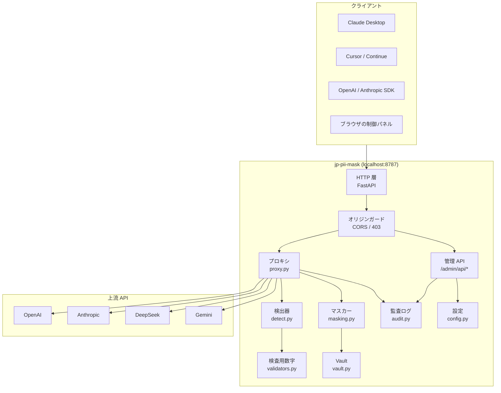

# アーキテクチャ

`jp-pii-mask` の内部設計と、その設計を選んだ理由をまとめます。

---

## 1. 全体構成



**依存の向き:** `proxy` → `masking` → `vault` / `detect` → `validators` / `words`。
逆向きの依存はありません。検出エンジン単体を切り出して評価・再利用できます。

---

## 2. 検出エンジン（`detect.py`）

### 3 層ハイブリッド

| 層 | 対象 | 手法 | 強み |
|---|---|---|---|
| 第 1 層 | 電話・郵便・カード・公的番号 | 正規表現 + **検査用数字** | 誤検出がほぼゼロ |
| 第 2 層 | 氏名・法人・住所 | 辞書アンカー + 文脈語 | 日本語の表記ゆれに対応 |
| 第 3 層 | 補完 | NER（GiNZA、任意） | 未知の固有名詞 |

### なぜ「検査用数字」が中核なのか

マイナンバー・法人番号・クレジットカードには検査用数字があります。
これは**偶然一致する確率が 1/11、1/9、1/10** であり、
「12 桁の数字」という緩いパターンから本物だけを残せます。

```
マイナンバー:  Σ P_n·Q_n を 11 で割った余りから検査用数字を導出
法人番号:      Σ P_n·Q_n を  9 で割った余りから検査用数字を導出
カード番号:    Luhn アルゴリズム
```

結果として「管理番号は 123456789019 です」のような文で
**誤ってマスクしない**判断ができます（`tests/test_detect.py` で検証済み）。

### 氏名検出の難しさと対処

日本語の氏名は空白で区切られないため、境界決定が最大の課題です。

```python
# 実際に踏んだ問題:
"田中太郎と申します。"  → 「と」を名として取り込み "田中太郎と" になる
"鈴木さくらさん"        → かな連続が敬称「さん」まで飲み込む
```

**対処:**
- 名の部分は**漢字・カタカナのみ**（ひらがなは助詞と衝突するため除外）
- かな名は**敬称の直前まで**を名とする（`鈴木さくらさん` → `鈴木さくら`）
- 敬称が無いかな名は文脈語がある場合のみ採用（信頼度を下げる）

```python
# さらに、姓と同形の一般名詞を抑制する
"林の中で森を抜けると原っぱに出た。"  → 人名として検出しない
```

### 法人名のアンカー

法人格（株式会社・一般社団法人…）をアンカーにします。

```python
# 前置形は法人格の直前に単語境界を要求する
# これが無いと「サンプル工業株式会社」の「株式会社」を前置形と誤認する
prefix = re.compile(rf"(?<!\w)({legal})\s*({name})")
# 後置形の名称からは助詞を除外し、開始位置を正しく決める
suffix = re.compile(rf"([^{excl}{particles}]{{1,24}}?)\s*(?:{legal})")
```

前置形では「株式会社サンプル商事**に勤めて**います」→ `サンプル商事` と
続きの文を切り落とします。

### 長文の NER（SudachiPy の入力上限）

GiNZA のトークナイザ SudachiPy は **1 回の入力が約 49 KB まで**です。
制限を超えると例外になり、**その文書の NER 検出が丸ごと失われます**
（ルールベースだけの結果になる。ベンチマークで発見）。

```
例: 61,845 文字 (172 KB) の文書
  → SudachiError: Input is too long, it can't be more than 49149 bytes
  → 修正前: NER 検出 0 件 (警告ログのみ)
  → 修正後: 45 KB ずつ分割して全断片に NER をかける (座標は文書全体に補正)
```

分割は文境界（句点・改行）を優先し、1 文だけで上限を超える場合のみ
文字境界で刻みます。分割・座標補正は `tests/test_detect.py` の
`TestNerChunking` が検証します（モデル不要の分割テスト + モデルがある
環境での座標テスト）。

### 重複の解決

3 層の候補は重なります。優先順位で解決します。

```
composite > checksum > regex > dict > ner
```

同順位なら信頼度、次に区間長で決めます。
「〒100-0001 東京都千代田区…」は 1 件の `POSTAL_ADDRESS_FULL` にまとめ、
内側の `POSTAL_CODE` / `ADDRESS` は捨てます。

---

## 3. 可逆マスキング（`masking.py` / `vault.py`）

### プレースホルダ設計

```
[氏名_1]  [電話番号_2]  [法人名_1]
```

**角括弧 + 日本語ラベル + 連番**を選んだ理由:

1. 角括弧は LLM がトークンとして保持しやすい
2. 日本語ラベルがあると、モデルが「固有名詞の代わり」と認識しやすい
3. 連番により、同じ人物が一貫して同じ記号になる（文脈が壊れない）

### 決定性

同一セッション内では `(種別, 原文)` → 同じプレースホルダ。
これにより:

```
入力: 田中太郎です。田中太郎は営業部です。
出力: [氏名_1]です。[氏名_1]は営業部です。
```

モデルは「同一人物」を正しく扱えます。

### セッション分離

会話 A の復元表が会話 B に使われると情報漏洩になります。
`x-jp-pii-session` ヘッダ → API キー → 既定、の優先順で分離します。

### 保存時の暗号化

```python
AES-GCM(key, nonce, plaintext, aad=b"jp-pii-mask-v1")
```

- 鍵は `~/.jp-pii-mask/key.bin` に `0600` で保存
- 鍵が無い場合は生成、`cryptography` が無い場合は平文保存にフォールバック
- **テストで「保存ファイルに原文が平文で現れないこと」を検証**

### 鍵の分離と DPAPI（`file mask` 向け）

`file mask` の出力はフォルダごと配布され得るため、**鍵を出力フォルダに
置かない**設計にしました（旧版は Vault の隣に `key.bin` を作っていました）。

```
proxy / CLI の Vault  :  ~/.jp-pii-mask/key.bin
file mask の対応表    :  ~/.jp-pii-mask/file-key.bin
                        (Windows では DPAPI で保護して保存)
```

- `Vault(key_path=...)` で保存先を注入できる（既定は従来の互換パス）
- Windows の保護は `CryptProtectData` を ctypes 経由で呼ぶ（追加依存なし）。
  ファイル先頭の `JPPMK1` マーカーで「保護済み」を判定し、
  別ユーザー / 別 PC では復号に失敗する（黙って別鍵を作らない）
- restore は「Vault の隣の `key.bin`」→「`file-key.bin`」の順に探す
  （旧バージョンの出力を壊さないため）
- e2e（`scripts/e2e_files.py`）で「出力フォルダに鍵が無い」「DPAPI 保護済み」を実測

### 復元の頑健性

LLM はプレースホルダを崩すことがあります（全角括弧にする、空白を入れる）。

```python
#[ 氏名 _ 1 ]   → 田中太郎   (厳密一致)
［氏名_1］      → 田中太郎   (全角括弧)
[氏名1]         → 田中太郎   (アンダースコア欠落)
[氏名_42]       → そのまま   (未知の番号は復元せず統計に計上)
```

復元できなかった件数は `restore_misses` として統計に現れます。

### ストリーミング復元（`StreamRestorer`）

**問題:** SSE のデルタはプレースホルダの途中で切れます。

```
chunk1: "…の携帯は[電"
chunk2: "話番号_1]です。"
```

**解決:** 末尾が未完のプレースホルダである可能性がある間は出力を保留します。

```python
def _pending_tail(buf):
    # 最後の開き括弧以降が完成形でなければ、その長さを返して保留
    ...
```

---

## 4. プロキシ（`proxy.py`）

### リクエスト側

JSON 全体を再帰的に走査し、文字列値をマスクします。

**除外規則（重要）:**

| 対象 | 理由 |
|---|---|
| `model` / `role` / `type` / `id` など | 構造キー。置換すると API が壊れる |
| `tools` / `functions` サブツリー全体 | JSON Schema。置換すると関数呼び出しが壊れる |

これは「マスクしすぎて AI が動かなくなる」ことを防ぐための設計です。

### 応答側

応答は `content` / `text` / `arguments` などのキーを中心に復元します。
キーに含まれない文字列でも、プレースホルダらしき形なら復元します
（モデルが独自のキーに埋め込む場合があるため）。

### 認証の扱い

```
設定の api_key  >  クライアントの Authorization  >  環境変数
```

`upstream_preset == "anthropic"` の場合は `x-api-key` と
`anthropic-version` を使います。

### オリジンガード

Tauri の webview は別オリジン（`tauri://localhost`）から管理 API を叩くため
CORS が必要です。一方 `/admin/api/mapping` は原文を返すため、
任意のサイトから読めては困ります。

**方針:** ローカル系オリジンのみ許可、それ以外の `Origin` 付き要求は 403。
`Origin` を送らない CLI / SDK はそのまま通します。

```
Origin: tauri://localhost    → 200 + CORS ヘッダ
Origin: https://evil.example → 403
(Origin なし)                → 200
```

### Host 検証（DNS リバインディング対策）

`Origin` だけでは足りません。悪意あるサイトが DNS を `127.0.0.1` に
向けると、ブラウザは**ローカルプロキシへ**リクエストを送ります。
このとき `Origin` は攻撃者サイトのままなので上のガードで止まりますが、
`Host` 検証も重ねて多層化します。

```
Host: 127.0.0.1:8787 / localhost / [::1] / tauri.localhost → 200
その他の Host                                              → 403
```

- 判定は `request.url.hostname`（ポート・角括弧を除去済み）
- **`127.0.0.1` 等のループバック bind 時のみ**厳格に判定する。
  `0.0.0.0` bind では LAN の実 IP が `Host` に載るため列挙が成立しない
- `Host` ヘッダの無い HTTP/1.0 的な要求は通す（CLI / SDK を壊さない）

### 監査ログ（`audit.py`）

「いつ・何件・どの種別をマスクしたか」を JSONL に残します（既定 OFF）。

- 記録するのは 時刻 / 操作種別 / セッションの SHA-256 先頭 12 桁 / 件数 / 種別名
- **原文・検出値・ファイルパス・ファイル名は記録しない**（漏洩経路にしない）
- 書込みはスレッドロック付き・1 MB でローテーション・失敗しても本体は止めない
- `GET /admin/api/audit` と `jp-pii-mask audit` が同じ内容を返す
  （GUI と CLI で別の表示ロジックを持たない）

---

## 5. ファイルマスク（`files.py` / `ocr.py`）

プロキシを通らない**ローカルの PDF・画像**を、同じ検出器と Vault で守ります。

### 処理の流れ

1. ページごとにテキスト層を取り出す（PDF。文字単位の座標つき）
2. テキストが無い／実質空のページは OCR に切り替える（`--ocr auto`）
3. 検出した個人情報を文字座標に紐づけ、矩形にまとめて黒塗り
4. **個人情報が 1 件も無いページはベクタのまま原文から複製**（画質を落とさない）
5. 出力は 3 点セット: `.masked.pdf`（本体）、`.masked.txt`（プレースホルダ文）、
   `.masked.vault`（対応表、AES-GCM。鍵は `~/.jp-pii-mask/file-key.bin` で
   **出力フォルダには置かない**）

個人情報のあったページはページ全体を画像化するため、出力 PDF の
**テキスト層から個人情報をコピーで取り出せません**。

### 座標変換の落とし穴（実バグの記録）

PDF の文字座標は左下原点、画像は左上原点。さらに `/Rotate` 付きページは
描画時に回転されるため、単純な上下反転では 90/180/270 度で黒塗りがずれます。

```
実際に起きたこと: テキスト層は消えるが、黒塗りは空白部分に描かれた
対処: 回転角ごとの変換式を「文字座標と描画画素の突き合わせ」で確定
      tests/test_files.py が回帰を防ぐ（画素で黒塗り位置を検証）
```

### OCR の扱い

- `winsdk`（Windows 標準 OCR）を任意依存として使う。クラウド送信は無い
- `--ocr auto`（既定）はテキスト層が実質空のページだけ OCR する
- OCR 不可の環境では、テキスト層のあるページだけ処理して警告を出す
- 読み取り精度がそのまま黒塗り精度になるため、目視確認を推奨（README 制限事項）
- **縦書きは Windows 標準 OCR 単体では読めない（実測）** — 横書き前提のため、
  縦組みの漢字・数字は判読不能な文字列になる（例: 縦組みの `09012345678` が
  `0C)01っ乁E一わC.C`）。これは「検出できず黒塗りされない」に直結する
- **Tesseract（任意）を補助バックエンドに使う** — `JP_PII_MASK_TESSERACT`
  （exe かディレクトリ）> PATH > 標準のインストール先の順に実行ファイルを探し、
  `jpn_vert`（`--psm 5`）→ `jpn`（`--psm 6`）の順に試す。導入されていれば、
  Windows OCR が使えない環境では主系として、使える環境でも「OCR したのに
  個人情報が 0 件」のページは再認識する。縦書きに対する Windows OCR は
  空文字ではなく文字化けを返すため、空判定だけでは足りないためである。
  `JP_PII_MASK_TESSDATA` で学習データの場所を指定できる。呼び出しはローカルの
  子プロセス（画像は一時 PNG 経由）で、クラウド送信は無い
- **Tesseract は同梱しない** — 実行ファイルサイズを変えず、利用者が導入した
  場合だけ使う。未導入でも Windows OCR の範囲で動作する
- **読めなかったら黙らない** — OCR を実行しても 1 文字も認識できず、
  テキスト層も無いページは警告を出す（縦書き・かすれ・低解像度の疑い）。
  「何も検出されなかった」と「読めなかった」を取り違えないための安全弁

### 復元の対象

復元できるのは `.masked.txt`（プレースホルダ入りテキスト）だけです。
`.masked.pdf` 自体は画像化されているため不可逆で、Vault は
「AI に渡したテキストの回答を戻す」ために使います。

---

## 6. 起動経路

### 単一実行ファイル化

```bash
python -m PyInstaller --onefile --name jp-pii-mask-server \
  --paths . --collect-all jp_pii_mask \
  --hidden-import uvicorn.logging \
  --hidden-import uvicorn.loops.auto \
  --hidden-import uvicorn.protocols.http.auto \
  --hidden-import uvicorn.protocols.websockets.auto \
  --hidden-import uvicorn.lifespan.on \
  scripts/sidecar_entry.py
```

**エントリは `scripts/sidecar_entry.py` を使う必要があります。**
`jp_pii_mask/cli.py` を直接指定すると、PyInstaller が `__main__` として
扱うため相対 import（`from .config import ...`）が解決できません。

### 標準出力の扱い（実バグの記録）

Tauri がサイドカーを起動すると標準出力はパイプになります。
Windows の既定コードページは cp932 であり、**絵文字を print すると
`UnicodeEncodeError` でプロセスごと終了**します。

```
UnicodeEncodeError: 'cp932' codec can't encode character '\U0001f319'
```

`cli._make_streams_robust()` が `errors="replace"` を設定して防いでいます。
この事象は実際に PyInstaller 生成物を起動して初めて発覚しました
（in-process のテストでは再現しません）。

---

## 7. テスト戦略

| 種別 | ファイル | 内容 |
|---|---|---|
| 検査用数字 | `test_validators.py` | 独立実装と突き合わせて判定を検証 |
| 検出 | `test_detect.py` | 検出できることに加え**誤検出しないこと**を検証 |
| マスク／復元 | `test_masking.py` | 往復一致、暗号化の実効性、崩れた入力の復元 |
| プロキシ | `test_proxy.py` | **実際の偽上流サーバ**を立てて実 HTTP で検証 |
| CLI | `test_cli.py` | cp932 環境で落ちないことを含む |
| ファイル | `test_files.py` | テキスト層除去・黒塗り画素・`/Rotate` の位置を実測 |
| 監査ログ | `test_audit.py` | 記録内容・ローテーション・無効化・書込み失敗の扱い |
| 検出精度 | `eval/` + `scripts/eval_detection.py` | 46 文書・173 ラベルの再現率・適合率を計測（下限 95% を `--check` で判定） |
| 性能 | `scripts/benchmark.py` | 検出〜復元の遅延を実測（ルールベース約 50 万文字/秒、NER 約 5,000 文字/秒） |
| 疎通確認 | `scripts/e2e_live.py` | 実プロセス 2 つ + 実 HTTP で 26 項目 |
| ファイル疎通 | `scripts/e2e_files.py` | CLI を実行し PDF・スキャン PDF・画像を 37 項目で確認（鍵の分離を含む） |

特に重視しているのは:

- **往復一致** — マスクして復元して元に戻ること
- **上流に原文が届かないこと** — 偽サーバで本文を実測
- **誤検出しないこと** — 普通の日本語が PII にならないこと

---

## 8. 今後の設計課題

- **NER の同梱** — GiNZA は重く、単一バイナリに含めるとサイズが激増する。
  別プロセス化か、軽量モデルの同梱を検討
- **人名辞書の拡張** — 未知の姓への対応。読み辞書の導入
- **段階的マスキング** — 「氏名は残すが番号は消す」のような種別ごとの制御
- **評価コーパスの拡充** — 現状 46 文書・173 ラベル。実文書由来の
  数百件規模へ広げ、種別ごとの下限を CI で固定する
- **監査ログの法人向け拡張** — SIEM への転送、端末識別（現状は
  セッションのハッシュのみで「誰が」は記録しない）
- **鍵のローテーション** — 現状は生成のみ。再暗号化の手順を整備する
